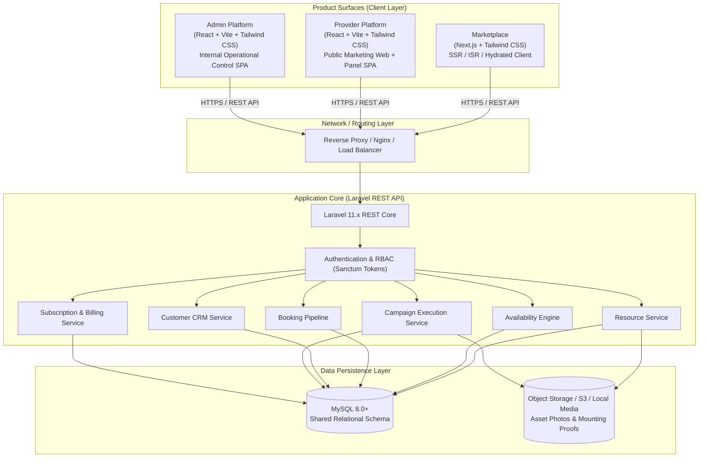

# 04 System Architecture Specification
**Project**: SODAARS  
**Document**: Technical Topology & System Architecture  
**Status**: Source of Truth  
**Version**: 1.0.0

---

## 1. High-Level Architectural Topology

SODAARS is structured as a decoupled multi-surface architecture. Three distinct client applications interact with a centralized, stateless Laravel REST API backed by a relational MySQL database.

---

## 2. Product Surface Separation & Responsibilities

| Surface | Host Technology | Execution Mode | Scope & Responsibilities |
|---|---|---|---|
| **Marketplace** | Next.js + Tailwind CSS | Hybrid SSR / SSG / Client Hydration | Public resource discovery, search/filtering, SEO landing pages, public detail views, and booking request generation. |
| **Provider Platform** | React + Vite + Tailwind CSS | Single Page Application (SPA) | Contains **both** the Provider Public Marketing Website (`/`) and the authenticated Provider Panel (`/panel/*`) within one unified codebase. |
| **Admin Platform** | React + Vite + Tailwind CSS | Single Page Application (SPA) | SODAARS operations control tower for tenant validation, marketplace governance, booking oversight, and system monitoring. |
| **API Backend** | Laravel + MySQL | Stateless REST Services | Authoritative business logic, multi-tenant isolation, availability conflict detection, state machines, and relational storage. |

---

## 3. Communication & Authentication Protocol

1. **Protocol**: Secure RESTful JSON over HTTPS (`Content-Type: application/json`).
2. **Stateless Authentication**:
   - Provider Panel & Admin SPA utilize HTTP Bearer Tokens (Laravel Sanctum).
   - Each token conveys identity, user role, and associated `organization_id` (Provider Tenant).
   - Marketplace public requests operate unauthenticated for browse/search; requests submit authenticated or verified guest payloads for booking generation.
3. **Multi-Tenant Scoping**:
   - Every provider operational query automatically injects the tenant boundary:
     $$\text{WHERE organization\_id} = \text{current\_user.organization\_id}$$
   - Platform Admin requests bypass tenant scoping via elevated admin capabilities.

---

## 4. Key Subsystem Engines

### 4.1 Resource Registry & Location Association
Resources (hoardings, unipoles, gantries) represent the billable, bookable display faces. Locations are normalized auxiliary entities containing geolocation (lat/long), address, and traffic metadata. A single Location can anchor multiple Resources.

### 4.2 Availability Scheduling Engine
Calculates asset availability across time spans using interval-based querying. Evaluates six deterministic states:
- `Available`
- `Booked`
- `Hold`
- `Provider Block`
- `Admin Block`
- `Maintenance`

### 4.3 Multi-Source Booking State Machine
Manages bookings initiated by:
1. `MARKETPLACE`
2. `PROVIDER`
3. `ADMIN`

Enforces strict linear and branched state transitions with transactional database isolation to prevent double-booking.

### 4.4 Campaign Mounting & Execution Engine
Tracks the post-booking physical execution cycle. Associates photo evidence, installer timestamps, and inspection logs to campaigns before triggering final billing reconciliation.

---

## 5. Media & Asset Storage Architecture

- **Asset Profiles**: High-resolution photography of outdoor structures (day view, night view, long-distance view).
- **Campaign Mounting Proofs**: Timestamped, geo-tagged field installation photos uploaded by provider operations teams.
- **Storage Adapter**: Laravel Flysystem configured for local disk in development and secure cloud object storage (S3-compatible) in production `[TBD: Storage Provider details]`.
