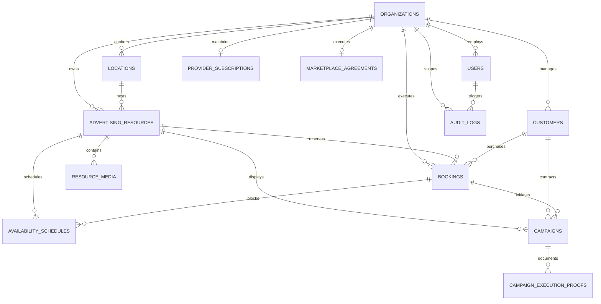

# 08 Database Architecture Specification
**Project**: SODAARS  
**Document**: Relational Data Schema & Entity Relationships  
**Status**: Source of Truth  
**Version**: 1.0.0

---

## 1. Relational Entity Overview

The SODAARS persistence layer is architected on **MySQL 8.0+** using the **InnoDB** storage engine with `utf8mb4_unicode_ci` character encoding. Foreign key constraints enforce referential integrity across all transactional workflows.



---

## 2. Core Entity Schemas

### 2.1 `organizations` (Provider Tenants)
| Column | Type | Constraints | Description |
|---|---|---|---|
| `id` | BIGINT UNSIGNED | PK, AUTO_INCREMENT | Unique identifier for Provider Organization. |
| `name` | VARCHAR(191) | NOT NULL | Legal corporate or trade entity name. |
| `slug` | VARCHAR(191) | UNIQUE, NOT NULL | URL-safe slug for provider references. |
| `gstin` | VARCHAR(15) | NULLABLE | 15-character Indian Goods & Services Tax ID. |
| `phone` | VARCHAR(20) | NOT NULL | Primary contact phone number. |
| `email` | VARCHAR(191) | NOT NULL | Billing and corporate email address. |
| `registered_resource_count` | INT UNSIGNED | NOT NULL DEFAULT 0 | Total registered resources (active + inactive). |
| `status` | ENUM | NOT NULL DEFAULT 'pending' | `pending`, `active`, `suspended`, `inactive`. |
| `created_at` / `updated_at` | TIMESTAMP | NOT NULL | Standard audit timestamps. |

### 2.2 `users`
| Column | Type | Constraints | Description |
|---|---|---|---|
| `id` | BIGINT UNSIGNED | PK, AUTO_INCREMENT | System user identifier. |
| `organization_id` | BIGINT UNSIGNED | NULLABLE, FK (`organizations.id`) | NULL for Platform Admins and standalone Buyers. |
| `name` | VARCHAR(191) | NOT NULL | User's full name. |
| `email` | VARCHAR(191) | UNIQUE, NOT NULL | Authentication identity. |
| `password` | VARCHAR(255) | NOT NULL | Bcrypt/Argon2 hashed credentials. |
| `phone` | VARCHAR(20) | NULLABLE | Contact telephone. |
| `role` | ENUM | NOT NULL | `buyer_guest`, `buyer_registered`, `provider_owner`, `provider_manager`, `provider_viewer`, `admin_super`, `admin_operations`, `admin_support`. |
| `status` | ENUM | NOT NULL DEFAULT 'active' | `active`, `suspended`, `invited`. |

### 2.3 `locations` (Supporting Geographic Data)
> [!NOTE]
> Locations exist strictly as supporting spatial records for Advertising Resources. They are not primary provider navigation items.

| Column | Type | Constraints | Description |
|---|---|---|---|
| `id` | BIGINT UNSIGNED | PK, AUTO_INCREMENT | Location site record ID. |
| `organization_id` | BIGINT UNSIGNED | NOT NULL, FK (`organizations.id`) | Tenant owning or anchoring the site. |
| `name` | VARCHAR(191) | NOT NULL | Site name (e.g., "Benz Circle Junction"). |
| `address_line1` | VARCHAR(255) | NOT NULL | Physical street address. |
| `city` | VARCHAR(100) | NOT NULL, INDEX | Municipal city name. |
| `state` | VARCHAR(100) | NOT NULL | State / Province. |
| `pincode` | VARCHAR(10) | NOT NULL | Postal index number. |
| `latitude` | DECIMAL(10, 8) | NOT NULL | Geolocation coordinate. |
| `longitude` | DECIMAL(11, 8) | NOT NULL | Geolocation coordinate. |
| `landmark` | VARCHAR(255) | NULLABLE | Prominent local landmark description. |

### 2.4 `advertising_resources` (The Core Inventory Asset)
| Column | Type | Constraints | Description |
|---|---|---|---|
| `id` | BIGINT UNSIGNED | PK, AUTO_INCREMENT | Unique inventory resource ID. |
| `organization_id` | BIGINT UNSIGNED | NOT NULL, FK (`organizations.id`), INDEX | Provider tenant owning the asset. |
| `location_id` | BIGINT UNSIGNED | NOT NULL, FK (`locations.id`) | Physical anchoring site. |
| `resource_name` | VARCHAR(191) | NOT NULL | Display face name (e.g., "Unipole A - Facing MG Road"). |
| `resource_type` | ENUM | NOT NULL | `hoarding`, `billboard`, `unipole`, `gantry`, `bus_shelter`, `pole_ad`, `wall_mount`, `rooftop`, `bridge_panel`, `other_static`. |
| `width_ft` | DECIMAL(6, 2) | NOT NULL | Physical display width in feet. |
| `height_ft` | DECIMAL(6, 2) | NOT NULL | Physical display height in feet. |
| `total_area_sqft` | DECIMAL(8, 2) | NOT NULL | Generated: `width_ft * height_ft`. |
| `orientation` | ENUM | NOT NULL | `north`, `south`, `east`, `west`, `northeast`, `northwest`, `southeast`, `southwest`. |
| `illumination` | ENUM | NOT NULL | `front_lit`, `back_lit`, `non_lit`, `ambient`. |
| `facing` | VARCHAR(191) | NOT NULL | Traffic direction facing (e.g., "Towards City Center"). |
| `customer_price` | DECIMAL(12, 2) | NOT NULL | Provider regular street/customer rate (₹). |
| `sodaars_price` | DECIMAL(12, 2) | NOT NULL | Provider net marketplace settlement price (₹). |
| `marketplace_participation`| BOOLEAN | NOT NULL DEFAULT FALSE, INDEX | Flag enabling discovery in Marketplace. |
| `status` | ENUM | NOT NULL DEFAULT 'active', INDEX | `active`, `inactive`, `maintenance`, `decommissioned`. |
| `description` | TEXT | NULLABLE | Detailed site & visual notes. |
| `primary_media_url`| VARCHAR(255) | NULLABLE | Featured hero photograph of the resource. |

### 2.5 `resource_media` (Asset Photography & Visual Evidence)
| Column | Type | Constraints | Description |
|---|---|---|---|
| `id` | BIGINT UNSIGNED | PK, AUTO_INCREMENT | Unique media record ID. |
| `resource_id` | BIGINT UNSIGNED | NOT NULL, FK (`advertising_resources.id`, ON DELETE CASCADE), INDEX | Parent advertising resource asset. |
| `media_type` | ENUM | NOT NULL | `day_view`, `night_view`, `approach_view`, `structural_view`, `other`. |
| `file_url` | VARCHAR(255) | NOT NULL | Direct path or CDN URL to stored high-res image. |
| `thumbnail_url` | VARCHAR(255) | NULLABLE | Optimized responsive thumbnail URL. |
| `sort_order` | INT UNSIGNED | NOT NULL DEFAULT 0 | Display sequence in public carousels. |
| `caption` | VARCHAR(191) | NULLABLE | Optional descriptive caption. |
| `created_at` / `updated_at` | TIMESTAMP | NOT NULL | Standard audit timestamps. |

### 2.6 `availability_schedules`
| Column | Type | Constraints | Description |
|---|---|---|---|
| `id` | BIGINT UNSIGNED | PK, AUTO_INCREMENT | Schedule entry ID. |
| `resource_id` | BIGINT UNSIGNED | NOT NULL, FK (`advertising_resources.id`), INDEX | Resource to which calendar applies. |
| `start_date` | DATE | NOT NULL, INDEX | Inception date of block/booking. |
| `end_date` | DATE | NOT NULL, INDEX | Expiration date of block/booking. |
| `status` | ENUM | NOT NULL | `available`, `booked`, `hold`, `provider_block`, `admin_block`, `maintenance`. |
| `source_type` | ENUM | NOT NULL | `booking`, `provider_manual`, `admin_manual`, `maintenance_job`. |
| `source_id` | BIGINT UNSIGNED | NULLABLE | Polymorphic link to `bookings.id` or operational event. |
| `notes` | VARCHAR(255) | NULLABLE | Operational context for hold/block. |

### 2.7 `bookings`
| Column | Type | Constraints | Description |
|---|---|---|---|
| `id` | BIGINT UNSIGNED | PK, AUTO_INCREMENT | Primary booking record ID. |
| `booking_code` | VARCHAR(32) | UNIQUE, NOT NULL | Human-readable code (e.g., `BKG-2026-1049`). |
| `organization_id` | BIGINT UNSIGNED | NOT NULL, FK (`organizations.id`), INDEX | Servicing Provider. |
| `customer_id` | BIGINT UNSIGNED | NOT NULL, FK (`customers.id`) | Client or Agency. |
| `resource_id` | BIGINT UNSIGNED | NOT NULL, FK (`advertising_resources.id`) | Targeted static advertising resource. |
| `source` | ENUM | NOT NULL | `MARKETPLACE`, `ADMIN`, `PROVIDER`. |
| `start_date` | DATE | NOT NULL | Campaign start date. |
| `end_date` | DATE | NOT NULL | Campaign conclusion date. |
| `regular_customer_price` | DECIMAL(12, 2) | NOT NULL | Standard card rate at time of booking. |
| `provider_net_price` | DECIMAL(12, 2) | NOT NULL | Provider settlement baseline (SODAARS Price). |
| `agreed_markup_amount` | DECIMAL(12, 2) | NOT NULL DEFAULT 0.00 | Negotiated or platform markup applied. |
| `customer_adjustment_amount`| DECIMAL(12, 2) | NOT NULL DEFAULT 0.00 | Buyer discount or rate concession. |
| `final_invoiced_amount` | DECIMAL(12, 2) | NOT NULL | Total gross invoiced to buyer. |
| `status` | ENUM | NOT NULL, INDEX | `NEW`, `UNDER_REVIEW`, `PROVIDER_CONFIRMATION`, `CUSTOMER_CONFIRMATION`, `PAYMENT`, `CONFIRMED`, `ACTIVE`, `COMPLETED`, `CANCELLED`, `DECLINED`, `EXPIRED`, `REFUNDED`. |
| `notes` | TEXT | NULLABLE | Internal operational notes. |
| `created_by_user_id` | BIGINT UNSIGNED | NULLABLE, FK (`users.id`) | User initiating record. |

### 2.8 `customers` (CRM)
| Column | Type | Constraints | Description |
|---|---|---|---|
| `id` | BIGINT UNSIGNED | PK, AUTO_INCREMENT | Customer record ID. |
| `organization_id` | BIGINT UNSIGNED | NOT NULL, FK (`organizations.id`), INDEX | Provider managing this client relationship. |
| `company_name` | VARCHAR(191) | NOT NULL | Client corporate entity. |
| `contact_person` | VARCHAR(191) | NOT NULL | Primary representative. |
| `phone` | VARCHAR(20) | NOT NULL | Primary contact phone. |
| `email` | VARCHAR(191) | NOT NULL | Contact email address. |
| `customer_type` | ENUM | NOT NULL | `advertising_agency`, `direct_enterprise`, `local_business`, `corporate_brand`. |
| `origin_source` | ENUM | NOT NULL DEFAULT 'provider_direct' | `provider_direct`, `marketplace`. |
| `status` | ENUM | NOT NULL DEFAULT 'active' | `active`, `dormant`, `blacklisted`. |

### 2.9 `campaigns`
| Column | Type | Constraints | Description |
|---|---|---|---|
| `id` | BIGINT UNSIGNED | PK, AUTO_INCREMENT | Campaign operational job ID. |
| `campaign_code` | VARCHAR(32) | UNIQUE, NOT NULL | Reference code (e.g., `CMP-2026-882`). |
| `organization_id` | BIGINT UNSIGNED | NOT NULL, FK (`organizations.id`), INDEX | Provider executing mounting. |
| `customer_id` | BIGINT UNSIGNED | NOT NULL, FK (`customers.id`) | Client brand. |
| `booking_id` | BIGINT UNSIGNED | NOT NULL, FK (`bookings.id`), UNIQUE | Originating confirmed booking. |
| `resource_id` | BIGINT UNSIGNED | NOT NULL, FK (`advertising_resources.id`) | Display asset face. |
| `location_id` | BIGINT UNSIGNED | NOT NULL, FK (`locations.id`) | Display physical site. |
| `campaign_name` | VARCHAR(191) | NOT NULL | Brand campaign title. |
| `start_date` | DATE | NOT NULL | Physical display start date. |
| `end_date` | DATE | NOT NULL | Physical display end date. |
| `campaign_status` | ENUM | NOT NULL DEFAULT 'scheduled' | `scheduled`, `running`, `concluded`, `cancelled`. |
| `execution_status` | ENUM | NOT NULL DEFAULT 'planned' | `planned`, `in_execution`, `proof_submitted`, `completed`. |

### 2.10 `campaign_execution_proofs`
| Column | Type | Constraints | Description |
|---|---|---|---|
| `id` | BIGINT UNSIGNED | PK, AUTO_INCREMENT | Proof record ID. |
| `campaign_id` | BIGINT UNSIGNED | NOT NULL, FK (`campaigns.id`), INDEX | Target campaign. |
| `proof_type` | ENUM | NOT NULL | `mounting_photo`, `day_view`, `night_illumination`, `inspection_photo`. |
| `file_url` | VARCHAR(255) | NOT NULL | Path to uploaded high-res proof image. |
| `captured_at` | DATETIME | NOT NULL | Timestamp when photo was captured in field. |
| `uploaded_by_user_id` | BIGINT UNSIGNED | NOT NULL, FK (`users.id`) | Provider staff member logging proof. |
| `verification_status` | ENUM | NOT NULL DEFAULT 'pending' | `pending`, `verified`, `rejected` (Audited manually). |
| `verification_notes` | TEXT | NULLABLE | Staff audit notes (No automated AI claimed). |

### 2.11 `provider_subscriptions`
| Column | Type | Constraints | Description |
|---|---|---|---|
| `id` | BIGINT UNSIGNED | PK, AUTO_INCREMENT | Subscription ledger ID. |
| `organization_id` | BIGINT UNSIGNED | NOT NULL, FK (`organizations.id`), UNIQUE | Target provider tenant. |
| `current_tier` | ENUM | NOT NULL | `tier_1_to_50`, `tier_51_to_100`. |
| `registered_resources_count`| INT UNSIGNED | NOT NULL | Total registered resources at billing anchor. |
| `monthly_fee` | DECIMAL(10, 2) | NOT NULL | ₹4,999.00 or ₹8,999.00 strictly. |
| `status` | ENUM | NOT NULL DEFAULT 'active' | `active`, `past_due`, `cancelled`. |
| `next_billing_date`| DATE | NOT NULL | Next scheduled invoice date. |

### 2.12 `marketplace_agreements`
| Column | Type | Constraints | Description |
|---|---|---|---|
| `id` | BIGINT UNSIGNED | PK, AUTO_INCREMENT | Agreement identifier. |
| `organization_id` | BIGINT UNSIGNED | NOT NULL, FK (`organizations.id`), UNIQUE | Contracting provider. |
| `agreement_code` | VARCHAR(32) | UNIQUE, NOT NULL | Reference code (e.g., `AGR-2026-004`). |
| `status` | ENUM | NOT NULL DEFAULT 'draft' | `draft`, `active`, `suspended`, `terminated`. |
| `default_markup_rate` | DECIMAL(5, 2) | NOT NULL | Configurable default markup percentage. |
| `terms_accepted_at` | TIMESTAMP | NULLABLE | Provider electronic acceptance timestamp. |
| `approved_by_admin_id`| BIGINT UNSIGNED | NULLABLE, FK (`users.id`) | SODAARS Admin counter-approval. |

### 2.13 `audit_logs` (System-Wide Security & Compliance)
| Column | Type | Constraints | Description |
|---|---|---|---|
| `id` | BIGINT UNSIGNED | PK, AUTO_INCREMENT | Unique audit entry ID. |
| `user_id` | BIGINT UNSIGNED | NULLABLE, FK (`users.id`) | Acting user. NULL for unauthenticated actions. |
| `organization_id` | BIGINT UNSIGNED | NULLABLE, FK (`organizations.id`), INDEX | Provider tenant scope. |
| `event` | VARCHAR(100) | NOT NULL, INDEX | Event identifier (e.g., `booking.status_change`, `block.created`). |
| `auditable_type` | VARCHAR(191) | NOT NULL | Eloquent model class. |
| `auditable_id` | BIGINT UNSIGNED | NOT NULL | Target entity primary key ID. |
| `old_values` | JSON | NULLABLE | Pre-mutation field attributes. |
| `new_values` | JSON | NULLABLE | Post-mutation field attributes. |
| `ip_address` | VARCHAR(45) | NULLABLE | Client IP address (IPv4 / IPv6). |
| `created_at` | TIMESTAMP | NOT NULL | Immutable event timestamp. |

---

## 3. Mandatory Database Indices

```sql
-- Fast multi-attribute filtering for Marketplace public catalog
CREATE INDEX idx_mkt_search ON advertising_resources (marketplace_participation, status, resource_type, customer_price);

-- Date-range overlap indexing for Availability Engine
CREATE INDEX idx_availability_dates ON availability_schedules (resource_id, start_date, end_date, status);

-- Tenant boundary isolation indexes
CREATE INDEX idx_tenant_resources ON advertising_resources (organization_id, status);
CREATE INDEX idx_tenant_bookings ON bookings (organization_id, status, start_date);
CREATE INDEX idx_tenant_campaigns ON campaigns (organization_id, campaign_status);
```
