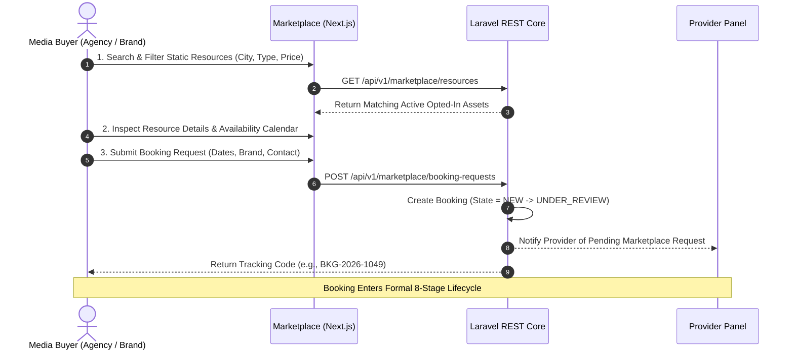

# 10 Marketplace Specification
**Project**: SODAARS  
**Document**: Public Marketplace Platform & Buyer Journey  
**Status**: Source of Truth  
**Version**: 1.0.0

---

## 1. Marketplace Mission & Core Principles

The SODAARS Marketplace is a high-visibility discovery and request channel built on **Next.js** and styled with **Tailwind CSS**. It enables advertisers, agencies, and enterprise marketing teams to discover, evaluate, and request static physical outdoor advertising assets across cities.

```
┌────────────────────────────────────────────────────────────────────────┐
│                     MARKETPLACE GUIDING PRINCIPLES                     │
├────────────────────────────────────────────────────────────────────────┤
│ 1. SUPPLEMENTAL CHANNEL   │ An expansion channel, not a monopoly.      │
│                            │ Does NOT replace provider direct clients.  │
├────────────────────────────┼────────────────────────────────────────────┤
│ 2. PROVIDER SOVEREIGNTY   │ Provider controls marketplace opt-in       │
│                            │ on an asset-by-asset basis.                │
├────────────────────────────┼────────────────────────────────────────────┤
│ 3. PARTICIPATION ≠ AVAIL. │ Opted-in assets remain subject to real-time│
│                            │ availability, holds, and direct bookings.  │
├────────────────────────────┼────────────────────────────────────────────┤
│ 4. ZERO FALSE CLAIMS      │ No guaranteed bookings, leads, revenue, or │
│                            │ customer demand are ever promised.         │
└────────────────────────────┴────────────────────────────────────────────┘
```

---

## 2. Customer Booking Journey

The Marketplace does **not** operate as an instant point-of-sale checkout. Physical outdoor advertising requires location validation, artwork sizing verification, and operational feasibility confirmation.



---

## 3. Catalog & Faceted Search Architecture

### 3.1 Search & Filter Dimensions
- **Location**: City, Landmark, Municipal Zone.
- **Resource Type (Static Only)**:
  - Hoardings / Traditional Billboards
  - Unipoles
  - Gantries
  - Bus Shelters (BQS)
  - Pole Ads
  - Wall Mounts
  - Rooftops
  - Bridge Panels
- **Dimensions & Area**: Minimum and maximum square footage.
- **Illumination**: Front-Lit, Back-Lit, Non-Lit, Ambient.
- **Orientation / Traffic Facing**: Direction of vehicle/pedestrian flow.
- **Date Window**: Start Date to End Date (verifies against `availability_schedules`).
- **Price Range**: Monthly or campaign budget filters.

### 3.2 Display Cards & Detail Views
Every resource card and detail view renders:
1. **Primary & Secondary Photography**: Daytime street angle, night illuminated view, approach distance shot.
2. **Key Physical Specifications**: Dimensions ($W \times H$), total square footage, illumination technology.
3. **Location Attributes**: Map pinpoint, physical landmark, street corridor.
4. **Transparent Pricing**: Displaying the regular rate card alongside the SODAARS marketplace price (calculated via agreed markup).
5. **Availability Status**: Real-time calendar indicator showing open slots for selected dates.

---

## 4. Resource Participation Governance

1. **Provider Control**: A provider toggles `marketplace_participation: true|false` directly from the Resource Management module in the Provider Panel.
2. **Agreement Prerequisite**: A resource cannot be surfaced in the Marketplace until the provider has signed the **Marketplace Agreement** and SODAARS Admin has counter-approved the tenant.
3. **Availability Override**: If a participating resource is booked via a direct provider client, the Availability Engine immediately marks the resource as unavailable in the Marketplace for those dates.
