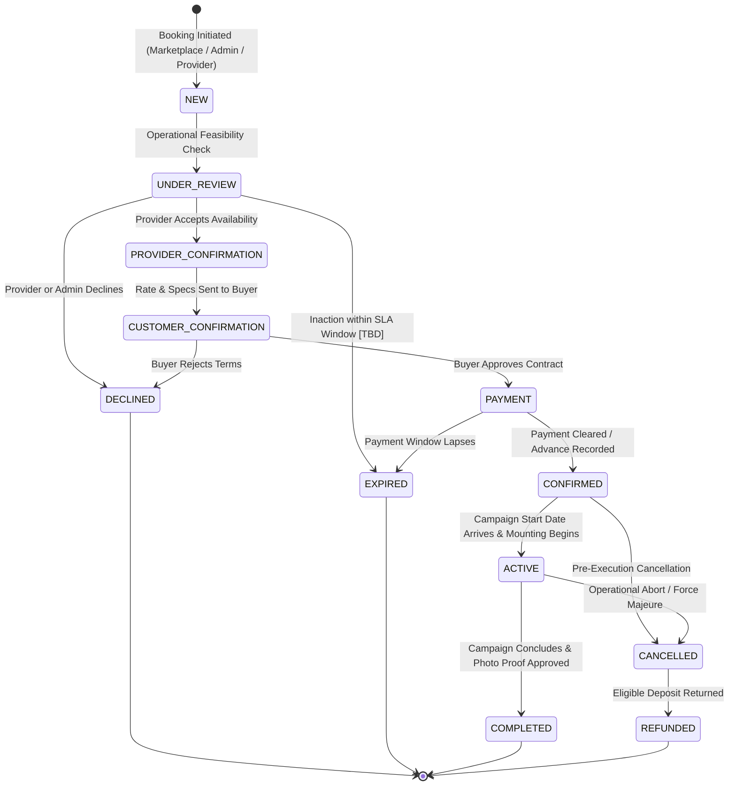

# 13 Booking Workflow Specification
**Project**: SODAARS  
**Document**: Multi-Source Booking Lifecycle & State Transitions  
**Status**: Source of Truth  
**Version**: 1.0.0

---

## 1. Booking Sources

Bookings within SODAARS originate from three distinct operational channels:

```
┌────────────────────────────────────────────────────────────────────────┐
│                        BOOKING CHANNEL SOURCES                         │
├─────────────────┬──────────────────────────────────────────────────────┤
│ 1. MARKETPLACE  │ Initiated publicly by media buyers, brands, or       │
│                 │ agencies browsing the SODAARS Marketplace.           │
├─────────────────┼──────────────────────────────────────────────────────┤
│ 2. ADMIN        │ Initiated or coordinated by SODAARS operations staff │
│                 │ on behalf of national enterprise accounts or multi-  │
│                 │ city campaign packages.                              │
├─────────────────┼──────────────────────────────────────────────────────┤
│ 3. PROVIDER     │ Initiated directly by the media provider's sales     │
│                 │ team for direct local clients, regular agencies, and │
│                 │ long-term renewal contracts.                         │
└─────────────────┴──────────────────────────────────────────────────────┘
```

> [!IMPORTANT]
> **No Instant Confirmation**: Outdoor advertising requires physical inventory verification, artwork dimension checks, and municipal compliance. Therefore, **no Marketplace booking is ever instantly confirmed upon submission**.

---

## 2. Definitive Booking Lifecycle State Machine

The platform strictly enforces the linear and branching state transitions depicted below:



---

## 3. State Definitions & System Actions

| Lifecycle State | Operational Definition | System & Inventory Action |
|---|---|---|
| `NEW` | Raw booking request submitted into the system. | Availability Engine creates a provisional soft hold; alerts assigned operational staff. |
| `UNDER_REVIEW` | Feasibility, artwork parameters, and calendar slots are actively being inspected. | Resource dates marked as `Hold` in the calendar grid. |
| `PROVIDER_CONFIRMATION` | Asset owner verifies physical site availability and accepts net settlement terms. | Calendar hold is reinforced; commercial contract summary generated. |
| `CUSTOMER_CONFIRMATION` | Buyer reviews finalized terms, display specifications, and net invoiced amount. | Awaiting buyer electronic authorization. |
| `PAYMENT` | Contract accepted; awaiting initial deposit, advance, or formal purchase order. | Payment gateway invoice issued or offline remittance record prepared. |
| `CONFIRMED` | Funds cleared or enterprise credit approved; binding contract finalized. | Availability state transitions from `Hold` to **`Booked`**. Campaign execution record generated. |
| `ACTIVE` | Display start date reached; physical media is mounted and displayed in the field. | Field crew submits daily/campaign mounting proofs; asset status locked. |
| `COMPLETED` | Display period elapsed; mounting proofs verified; final invoice closed. | Availability state returns to `Available` for future dates; provider payout eligible. |
| `CANCELLED` | Booking terminated before or during display run. | Calendar slot unlocked; audit log records reason. |
| `DECLINED` | Rejected by provider due to content conflict, prior hold, or commercial terms. | Calendar hold released immediately. |
| `EXPIRED` | Required action (approval or payment) timed out. | Provisional reservation purged from calendar. |
| `REFUNDED` | Monetary deposit returned to client following valid cancellation. | Financial reconciliation ledger updated. |

---

## 4. Concurrency & Double-Booking Prevention

To guarantee zero double-booking across Marketplace, Admin, and Provider operations:
1. **Pessimistic Locking**: Availability checks during state advancement use SQL row locks:
   ```sql
   SELECT * FROM availability_schedules 
   WHERE resource_id = :id 
     AND (start_date <= :end AND end_date >= :start)
     AND status IN ('booked', 'provider_block', 'admin_block', 'maintenance')
   FOR UPDATE;
   ```
2. **Transaction Rollback**: If an overlapping active reservation exists, the API aborts the request with `422 Unprocessable Entity` (`RESOURCE_ALREADY_RESERVED`).
