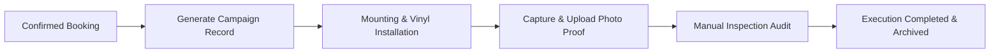

# 17 Campaign Execution Specification
**Project**: SODAARS  
**Core Solution 5**: Campaign Execution  
**Official Description**: *Mounting photo proof & audit trails*  
**Status**: Source of Truth  
**Version**: 1.0.0

---

## 1. Solution Identity & Execution Flow

**Campaign Execution** bridges contracted agreements with real-world physical operations. It governs vinyl printing logistics, site mounting, time-stamped proof-of-performance photography, and client audit verification.



---

## 2. Definitive Execution Lifecycle

Campaign field execution moves through four deterministic operational milestones:

```
┌────────────────────────────────────────────────────────────────────────┐
│                        CAMPAIGN EXECUTION STATES                       │
├───────────────────┬────────────────────────────────────────────────────┤
│ 1. Planned        │ Booking confirmed. Vinyl printing and field crew   │
│                   │ scheduling underway. Pre-mounting stage.           │
├───────────────────┼────────────────────────────────────────────────────┤
│ 2. In Execution   │ Vinyl delivered to site. Mounting crew on-site     │
│                   │ executing physical installation on the asset face. │
├───────────────────┼────────────────────────────────────────────────────┤
│ 3. Proof Submitted│ Field team captures and uploads high-resolution    │
│                   │ photos (day view, night view). Awaiting review.    │
├───────────────────┼────────────────────────────────────────────────────┤
│ 4. Completed      │ Proof reviewed and accepted. Audit record locked.  │
│                   │ Payouts and contract milestones finalized.         │
└───────────────────┴────────────────────────────────────────────────────┘
```

---

## 3. Campaign Record Attributes

Each Campaign record binds together the commercial, physical, and field data:

| Attribute | Type | Description |
|---|---|---|
| **Campaign Name** | String | Brand or campaign title (e.g., "Tata EV - Festive Launch 2026"). |
| **Customer** | Relation | Contracting Client / Advertising Agency. |
| **Booking** | Relation | Originating confirmed booking contract (`bookings.id`). |
| **Advertising Resource** | Relation | Specific static asset face reserved for display. |
| **Location** | Relation | Supporting physical site address and coordinates. |
| **Start Date** | Date | Scheduled first day of physical public display. |
| **End Date** | Date | Scheduled final day before flex removal/dismantling. |
| **Campaign Status** | Enum | Operational schedule: `scheduled`, `running`, `concluded`, `cancelled`. |
| **Execution Status** | Enum | Field milestone: `planned`, `in_execution`, `proof_submitted`, `completed`. |
| **Photo Proof Gallery** | Array | Set of verified field photos linked to timestamps. |
| **Notes** | Text | Installer field remarks, lighting conditions, or municipal notices. |

---

## 4. Mounting Photo Proof Governance

> [!CAUTION]
> **NO AUTOMATED PHOTO VERIFICATION**:  
> SODAARS does **not** claim automated AI/computer vision photo verification. All proofs are audited through manual operational inspection by provider supervisors and SODAARS platform auditors.

### 4.1 Proof Standards & Evidence Requirements
To transition from `Proof Submitted` to `Completed`, the upload must satisfy:
1. **Daytime Approach Photograph**: Clear view showing the mounted vinyl, structural borders, and traffic approach perspective.
2. **Nighttime Illumination Photograph**: For illuminated assets (`front_lit`, `back_lit`), a photograph captured after dark verifying light functionality.
3. **Capture Metadata**: EXIF timestamp and geo-location coordinates recorded upon field capture.

### 4.2 Audit Trails
Every upload, rejection, or approval records:
- Uploading User ID & Role (`provider_manager` / field installer)
- Audit Inspector User ID & Role (`provider_owner` or `admin_operations`)
- Timestamp of approval or rejection rationale
- Unalterable archive copy stored in media storage
