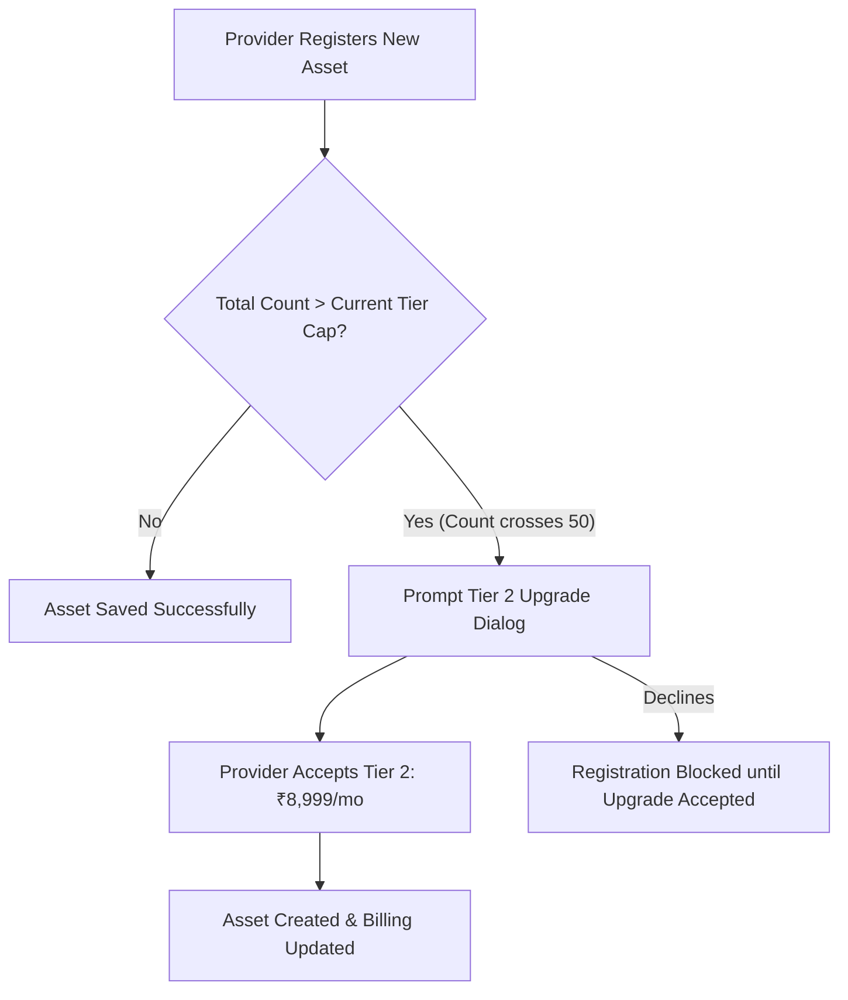

# 18 Subscription & Billing Specification
**Project**: SODAARS  
**Document**: Provider SaaS Subscription Tiers & Billing Rules  
**Status**: Source of Truth  
**Version**: 1.0.0

---

## 1. Fixed Subscription Tiers

SODAARS licenses the Provider Panel and its 5 Core Solutions under a transparent, fixed monthly SaaS pricing structure.

```
┌────────────────────────────────────────────────────────────────────────┐
│                      PROVIDER SUBSCRIPTION TIERS                       │
├─────────────────────┬──────────────────────────┬───────────────────────┤
│ Tier Designation    │ Total Registered Assets  │ Monthly Subscription  │
├─────────────────────┼──────────────────────────┼───────────────────────┤
│ Tier 1              │ 1 – 50 Resources         │ ₹4,999 / month        │
│ Tier 2              │ 51 – 100 Resources       │ ₹8,999 / month        │
│ Enterprise Tier     │ > 100 Resources          │ [TBD: Subject to      │
│                     │                          │ custom enterprise agt]│
└─────────────────────┴──────────────────────────┴───────────────────────┘
```

> [!IMPORTANT]
> **Total Registered Asset Rule**:
> The subscription tier is calculated based on **TOTAL REGISTERED RESOURCES**, not merely currently active assets. Inactive, under-maintenance, or seasonal assets count equally toward the threshold.

### 1.1 Canonical Compliance Scenario
- **Provider Asset Register**: 70 total registered physical resources.
- **Operational Status**: 45 assets are `Active` with mounted displays; 25 assets are `Inactive` or vacant.
- **Applicable Subscription**: **Tier 2 (51–100 resources)**.
- **Mandatory Monthly Fee**: **₹8,999 / month**.

---

## 2. Strict Commercial Boundaries

To prevent unauthorized fee inflation, the platform enforces these strict prohibitions:
1. **No Setup Fees**: Zero initial onboarding, data-migration, or setup charges.
2. **No Per-Booking SaaS Commissions**: SODAARS does **not** charge transaction fees or commission cuts on direct provider bookings managed through the software.
3. **No Hidden Add-Ons**: Core solutions (Resource Management, Availability Engine, Booking Pipeline, Customer CRM, Campaign Execution) are fully included without feature gating.
4. **Decoupled from Marketplace**: Opting assets into the public Marketplace requires no additional subscription tier upgrade.

---

## 3. Tier Upgrade & Quota Mechanics



1. **Threshold Audits**: Whenever a provider attempts to register asset #51, the system verifies tier status. If currently on Tier 1, an upgrade acceptance prompt is displayed.
2. **Billing Proration**: When upgrading mid-cycle from Tier 1 to Tier 2, the incremental difference is prorated for the remaining days of the billing period `[TBD: Proration Logic Details]`.

---

## 4. Invoicing, Tax, & Overdue Lifecycle

- **Tax Invoices**: Monthly subscription fees are subject to statutory Indian GST (18%) where applicable. A downloadable GST tax invoice is generated automatically on the 1st of each month.
- **Payment Grace Period**: Providers are granted a 7-day grace period from invoice generation.
- **Account Suspension**: If payment remains outstanding after 14 days, the account transitions to `past_due`. The Provider Panel enters read-only mode, and public Marketplace listings for that provider are temporarily suppressed until settled.
